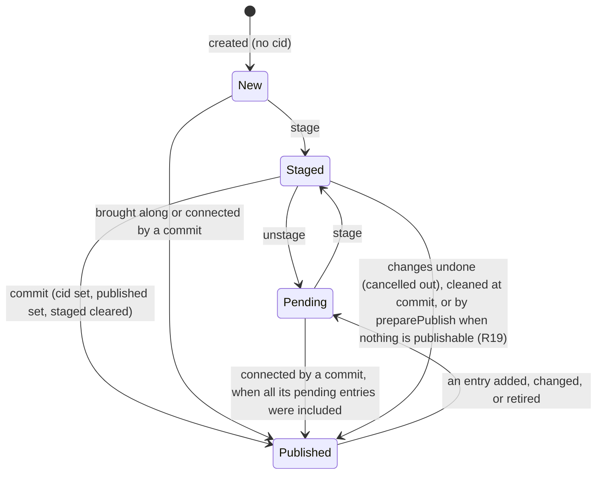

# Data Model: Publish Write-Layer Updates

There are two models: the **local graph** in JanusGraph, where this feature adds properties and two labels, and the **published documents** in IPFS, whose encoding is in [contracts/documents.md](contracts/documents.md). Decisions are explained in [research.md](research.md).

## Local graph

### Vertices

| Label | Existing properties | Added by this feature |
| --- | --- | --- |
| `Users` | `createdAt` | |
| `User` | `address`, `createdAt` | |
| `Device` | `uuid`, `createdAt` | `sequence`: latest own Update's sequence (absent ⇒ 0), an Integer key with `LOCK` consistency (research.md R9) · `head`: its CID |
| `Updates` | `createdAt` | |
| `Update` | *(new label)* | `cid`, `sequence`, `digest` (EIP-712 hash of the signed fields), `createdAt` (when it was recorded locally, as on every vertex) |
| `Spot` | `uuid`, `createdAt` | `cid?`: latest published version · `staged?: true` |
| `Content` | `uuid`, `type`, `createdAt` (`order` is removed; it moves to `AS`, research.md R11) | `cid?`: latest published version |
| `Blob` | `cid`, `size`, `createdAt` | |

### Edges

| Label | From → To | Existing properties | Added by this feature |
| --- | --- | --- | --- |
| `INCLUDES` | `Users` → `User` | `createdAt` | `author`: the `User`'s address, lowercase, the source of mounts' `creator` (research.md R14) |
| `USES` | `User` → `Device` | `createdAt` | |
| `COMMITS` | `Device` → `Updates` | `createdAt` | |
| `SPANS` | `Updates` → `Update` | *(new label)* | `createdAt` |
| `WRITES` | `User` → root `Spot` | | |
| `CONTAINS` | `Spot` → `Spot` | `path`, `uuid`, `createdAt` | `published?` |
| `MOUNT` | `Spot` → `Spot` | `order` | `published?` |
| `AS` | `Spot` → `Content` | `order` (the only `order` for Contents; the graph's schema makes `order` an Integer key), `createdAt` | `published?` |
| `IS` | `Content` → `Blob` | *(none)* | `uuid`, `published?` |
| `REMOVED` | `Spot` → `Spot`/`Content`, or `Content` → `Blob` | *(new label)* | `kind` (`CONTAINS` · `MOUNT` · `AS` · `IS`), `entry` (the entry's key; JanusGraph reserves `key` as a property name), `published`, `createdAt` |

No existing traversal follows `REMOVED` or `SPANS`, so listing, search, `fsEntries`, and moves are unchanged by them.

### Entry keys & fingerprints {#fingerprints}

Each entry edge has a **key**, which names it in a tombstone, and a **fingerprint**, which says whether it has changed since it was published. A fingerprint is the JSON of the listed fields, in the order shown.

| Edge | Key | Fingerprint fields | Published as |
| --- | --- | --- | --- |
| `CONTAINS` | its own `uuid` | `path`, child Spot `uuid` | Spot `contains` entry `{ uuid, path, target }` |
| `MOUNT` | target Spot `uuid` | target `uuid`, `creator` (the target owner's `INCLUDES.author`, absent when it's the publisher's own), `order` | Spot `mounts` entry `{ target, creator?, order }` |
| `AS` | `Content.uuid` | `Content.uuid`, `order`, `Content.type` | Spot `contents` entry `{ uuid, order, type }` |
| `IS` | its own `uuid` | `uuid`, `Blob.cid`, `Blob.size` | Content `blobs` entry `{ uuid, cid, size, type }`, with `type` from the `Content` |

A `CONTAINS` fingerprint leaves out `target`, the child's version CID. A child's new version doesn't change its parent's entry (FR-011).

### Derived states

- **Pending entry**: an entry edge whose `published` is missing or differs from its fingerprint, or a `REMOVED` marker. An exception: a marker and an edge with the same `kind`, `key`, and fingerprint on the same out-vertex cancel each other, as when something is moved away and back, and neither is pending.
- **Pending Content**: no `cid`, or a pending `IS` entry.
- **Pending Spot**: in the user's tree, meaning reachable from the root by `CONTAINS`, and with no `cid`, a pending entry, or a held Content that is pending through a current `AS`.
- **Unstaged pending Spot**: a pending Spot without `staged`.
- **Write layer**: the set of pending Spots and Contents. It is derived, not stored. It lives in the same tree as the published state, which holds both (FR-023).
- **Published entry edited**: a published entry whose fingerprint no longer matches, such as a renamed link or a mount with a new order. It's pending, and it's published again under the same key, replacing the earlier entry.

### Transitions



Prepare changes no state; the one exception is that its remote clears `staged` on Spots with nothing pending when nothing at all is publishable (research.md R19). A cancelled or failed publish leaves every state as it was (FR-014). A Spot connected by a commit with only some of its pending entries included (a partial version) gets a new `cid` and stays **Pending**.

### Retiring an entry

`retire({ source, edge })` replaces `drop()` everywhere an entry edge is removed:

- **Never published** (no `published`): drop the edge.
- **Published**: add a `REMOVED` marker on the same two vertices, carrying `kind`, `key`, and the old `published`, then drop the edge.

Commit also retires an edge it published that vanished during the publish. The marker carries the fingerprint commit has just published.

### Validation rules

- A Content has a single `type`, and a Spot holds at most one current Content of each type (FR-031). Encoding a Spot with two current `AS` edges to Contents of the same type throws.
- Serializing an `IS` without `uuid`, a `CONTAINS` without `uuid` or `path`, or an `order` that isn't a finite number throws. These are unexpected shapes, not sentinels.
- A `CONTAINS` cycle among the Spots of an Update throws, since a target CID can't be computed. Moves already refuse cycles.
- At most one `Spot` version, the user's root's first, ever has `root: true` (FR-028). The root is marked if and only if the root Spot has no `cid` when prepared. If that version is split into a chain (R18), only the first link carries the flag.
- A Spot has at most one `MOUNT` to a given target. Encoding a Spot with two throws a 400 naming the Spot and the target (research.md R14).
- Every encoded block is at most 1,048,576 bytes (FR-032). A version that would be larger is split into a chain (research.md R18). A single entry too large for a block throws a 400.
- `Device.sequence` advances only by the commit guard (research.md R9), by exactly 1.

## Published documents

The field-level encoding is in [contracts/documents.md](contracts/documents.md).

| Document | Identity | Links |
| --- | --- | --- |
| **Update** | its CID | `spots` & `contents` MST roots, `previous` Update |
| **MST node** | its CID | `l`/`t` subtrees, `v` → Spot or Content version |
| **Spot version** | its CID; the Spot itself by `uuid` | `previous` version, `contains[].target` → child versions |
| **Content version** | its CID; the Content by `uuid` | `previous` version, `blobs[].cid` → file data |

### Index membership

| Tree | Has an entry for |
| --- | --- |
| `spots` | each Spot with a version in the Update that had a `cid` before this Update (FR-021), plus the root in its first Update (FR-028). The entry names the Spot's newest version in the Update: the last link of a chain. |
| `contents` | each Content with a version in the Update (FR-022), naming its newest version |

### Version chains (FR-032)

A Spot or Content whose changed entries don't fit in one block gets several versions in one Update. Each version names the one before it as `previous`, and the first names the vertex's old `cid`. Entries are split in key order. The last version is the one indexed, the one targeted by parents' `contains` entries, and the one stored as the vertex's new `cid`. A reader folds the chain like any other run of versions.

### Example: US1-1, then US1-2

Update 1 (sequence 1, no `previous`):

- `/` v1: `root: true`, `contains: [{icon → icon/ v1}]`, with a `spots` entry
- `icon/` v1: `contains: [{hat → hat/ v1}]`
- `hat/` v1: `contains: [{top → top v1}]`
- `top` v1: `contents: [{C₁, order −1, image/svg+xml}]`
- `C₁` v1: `blobs: [{B₁, bafy…top, 1234, image/svg+xml}]`, with a `contents` entry

Update 2 (sequence 2, `previous` = Update 1):

- `hat/` v2: `previous` = `hat/` v1, `contains: [{fedora → fedora v1}]`, with a `spots` entry
- `fedora` v1: `contents: [{C₂, …}]`
- `C₂` v1, with a `contents` entry

`/` and `icon/` get no new version.

## Rebuilt tree (FR-018)

`rebuild()` and the test helper `snapshot()` both return:

```ts
interface Tree {
  contents: Array<{ uuid: string, order: number, type: string, blobs: Array<{ cid: string, size: number }> }>
  mounts: Array<{ target: string, creator?: string, order: number }>
  children: Record<string, Tree>  // by `path`
}
```

Entries are sorted by key, so two equal trees are deep-equal.
